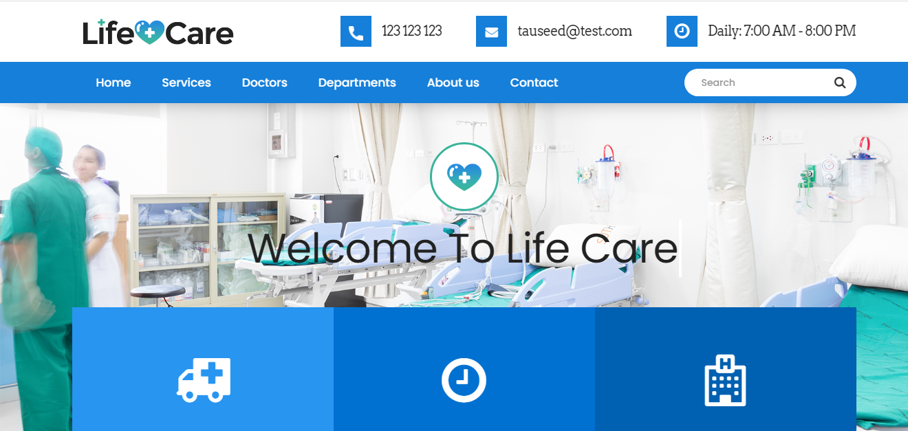
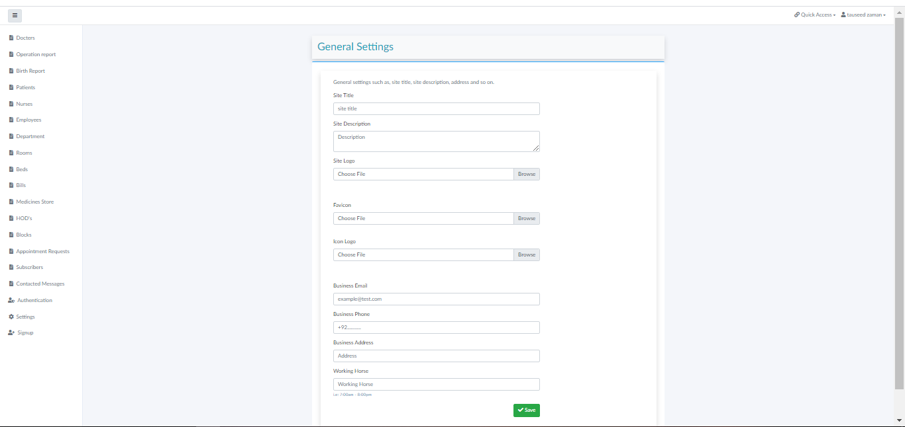
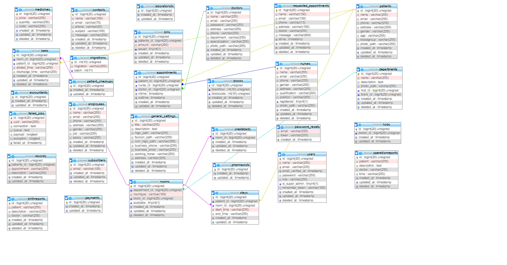

# Hospital Management System



## Front End


## Back End



## Database Tables



## Installation

Follow these instructions to set up and run the project locally on your Machine.

### Prerequisites

- [Git](https://git-scm.com/)
- [Composer](https://getcomposer.org/)
- [PHP](https://www.php.net/)

### Installation

1. Clone the repository:

```bash
   git clone https://github.com/tauseedzaman/hospitalMS.git
```
 ```bash
   cd hospitalMS
```

 ```bash
composer install
```
 ```bash
cp .env.example .env
```
```bash
php artisan key:generate
 ```
```bash
php artisan storage:link
```
 ```bash
 php artisan migrate:fresh --seed
```
 ```bash
 php artisan serve
```

## Admin Credentials
- **Email:** `admin@hospital.com` (or `tauseed@test.com`)
- **Password:** `admin123` (or `tauseed`)

### Accountant Credentials
- **Email:** `accountant@hospital.com`
- **Password:** `accountant123`

---
*Developed as a Hospital Management Information System Project - Rajkot, Gujarat.*
